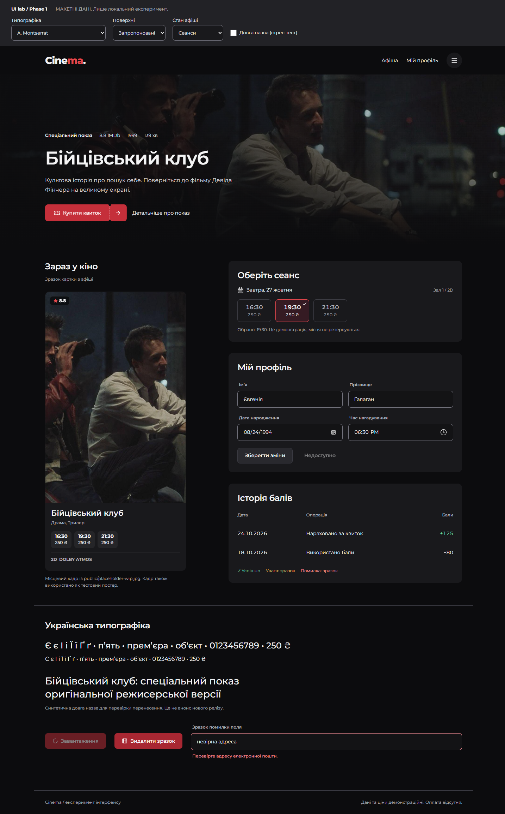
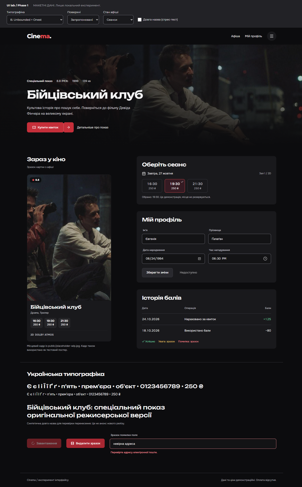
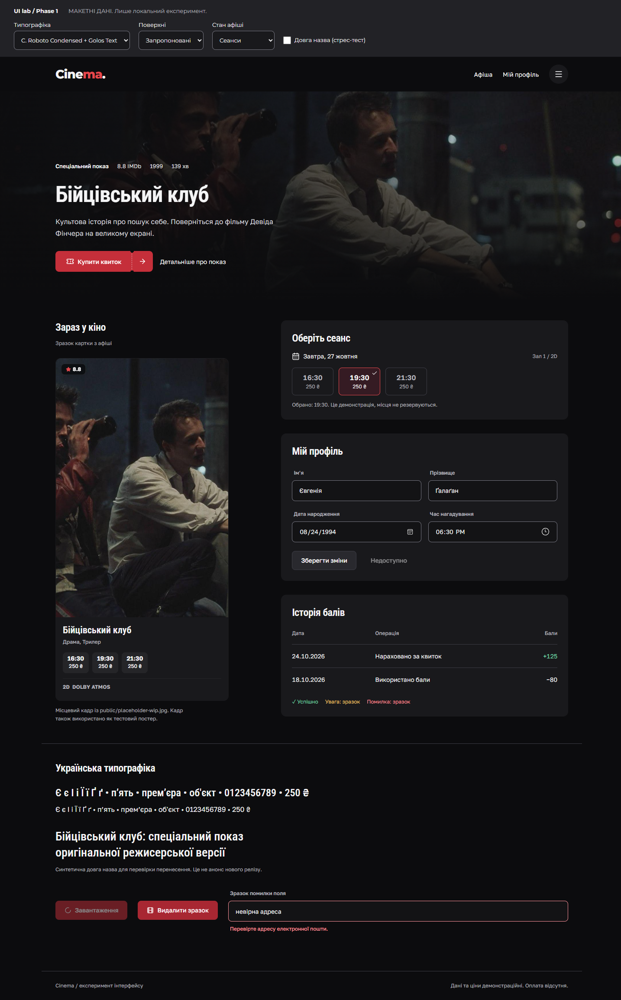

# Screenshot index

All images use **fixture data**, not a verified live catalogue. Chromium 156,
uk-UA locale, Europe/Kyiv timezone, 1× scale; fixed browser time
2026-10-26T09:00:00Z. Comparison captures use reduced motion, identical content,
selected session, layout and artwork. Height is 1000px for desktop/tablet and
844px for mobile; PNGs capture the full page. The configured 6px scrollbar can
reduce the content bitmap width by 6px. Compare matching widths and title states.

## Proposed surfaces, font comparison

| Width | A: Montserrat | B: Unbounded + Onest | C: Roboto Condensed + Golos Text |
| --- | --- | --- | --- |
| 1440 | [Normal](fixture-a-1440-normal.png), [long](fixture-a-1440-long.png) | [Normal](fixture-b-1440-normal.png), [long](fixture-b-1440-long.png) | [Normal](fixture-c-1440-normal.png), [long](fixture-c-1440-long.png) |
| 768 | [Normal](fixture-a-768-normal.png), [long](fixture-a-768-long.png) | [Normal](fixture-b-768-normal.png), [long](fixture-b-768-long.png) | [Normal](fixture-c-768-normal.png), [long](fixture-c-768-long.png) |
| 390 | [Normal](fixture-a-390-normal.png), [long](fixture-a-390-long.png) | [Normal](fixture-b-390-normal.png), [long](fixture-b-390-long.png) | [Normal](fixture-c-390-normal.png), [long](fixture-c-390-long.png) |
| 320 | [Normal](fixture-a-320-normal.png), [long](fixture-a-320-long.png) | [Normal](fixture-b-320-normal.png), [long](fixture-b-320-long.png) | [Normal](fixture-c-320-normal.png), [long](fixture-c-320-long.png) |

## Isolate surface changes

Keep A and compare the current/proposed treatments on the same board. This is
not a screenshot of the production homepage; see the production images below.

| Width | Current surfaces | Proposed surfaces |
| --- | --- | --- |
| 1440 | [Current](fixture-a-1440-current-surfaces.png) | [Proposed](fixture-a-1440-normal.png) |
| 390 | [Current](fixture-a-390-current-surfaces.png) | [Proposed](fixture-a-390-normal.png) |

## Interaction and state evidence

- [Profile edited and locally saved](fixture-c-390-form-saved.png)
- [Empty catalogue](fixture-c-390-empty.png)
- [Loading catalogue](fixture-c-390-loading.png)
- [Keyboard focus, ticket mask removed](fixture-c-1440-keyboard-focus.png)
- [Ticket hover with motion enabled](fixture-c-1440-ticket-hover.png)

## Existing production entry, intercepted read responses

No production styles changed for these captures. A visible MOCK DATA banner was
inserted only by Playwright. The unavailable remote grain/texture is intercepted
with an empty SVG. No payment, booking, auth or admin behavior is exercised.

| Width | Home | Sessions | Movie Details |
| --- | --- | --- | --- |
| 1440 | [home](fixture-production-home-1440.png) | [sessions](fixture-production-sessions-1440.png) | [details](fixture-production-details-1440.png) |
| 390 | [home](fixture-production-home-390.png) | [sessions](fixture-production-sessions-390.png) | [details](fixture-production-details-390.png) |

## Quick visual comparison at 1440px

| A | B | C |
| --- | --- | --- |
|  |  |  |
