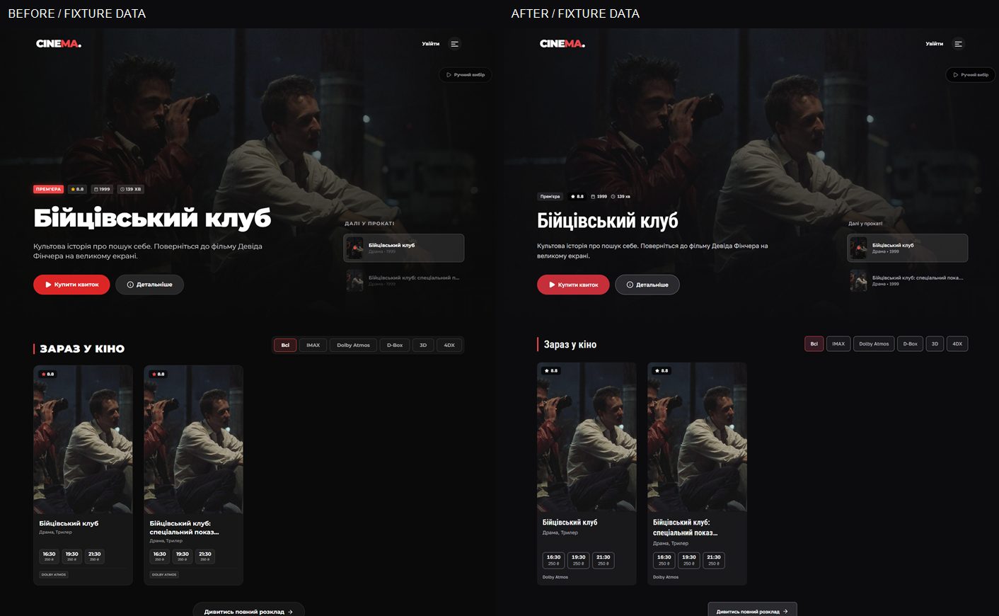
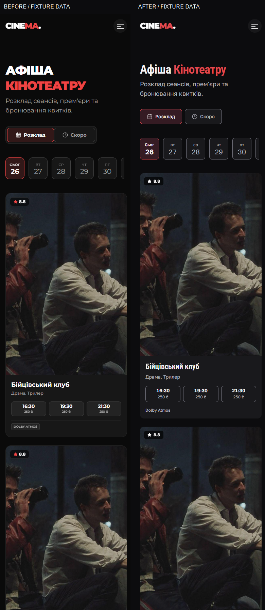

# Phase 2 screenshots

All images show fixture data, using the same existing local film still as both
backdrop and poster. They are not a live cinema schedule or official poster
review. `before-*` was captured before production edits; `after-*` shows Phase 2.
Full captures are unaltered. Comparison boards are labelled side-by-side crops;
`review-*` files crop the first 1000px for inspection. These are temporary and
must be removed with the lab in the final phase.

## Before / after production routes

| Width | Home before | Home after | Sessions before | Sessions after |
| --- | --- | --- | --- | --- |
| 1440 | [Before](before-home-1440.png) | [After](after-home-1440.png) | [Before](before-sessions-1440.png) | [After](after-sessions-1440.png) |
| 768 | [Before](before-home-768.png) | [After](after-home-768.png) | [Before](before-sessions-768.png) | [After](after-sessions-768.png) |
| 390 | [Before](before-home-390.png) | [After](after-home-390.png) | [Before](before-sessions-390.png) | [After](after-sessions-390.png) |
| 320 | [Before](before-home-320.png) | [After](after-home-320.png) | [Before](before-sessions-320.png) | [After](after-sessions-320.png) |

Quick comparison boards: [desktop Home](comparison-home-1440.png),
[mobile Sessions](comparison-sessions-390.png).

## States at 320px

| State | Before | After |
| --- | --- | --- |
| Coming-soon card | [Before](before-card-coming-soon-320.png) | [After](after-card-coming-soon-320.png) |
| Card session keyboard focus | [Before](before-card-focus-320.png) | [After](after-card-focus-320.png) |
| Home empty | [Before](before-home-empty-320.png) | [After](after-home-empty-320.png) |
| Home loading | [Before](before-home-loading-320.png) | [After](after-home-loading-320.png) |
| Sessions empty | [Before](before-sessions-empty-320.png) | [After](after-sessions-empty-320.png) |
| Sessions loading | [Before](before-sessions-loading-320.png) | [After](after-sessions-loading-320.png) |

## Additional after checks

| Width | Long hero title | Actual shared components | Profile settings | Booking session picker only |
| --- | --- | --- | --- | --- |
| 1440 | [Title](after-home-long-1440.png) | [Controls](after-shared-controls-1440.png) | [Profile](after-profile-1440.png) | [Booking](after-booking-session-1440.png) |
| 768 | [Title](after-home-long-768.png) | [Controls](after-shared-controls-768.png) | [Profile](after-profile-768.png) | [Booking](after-booking-session-768.png) |
| 390 | [Title](after-home-long-390.png) | [Controls](after-shared-controls-390.png) | [Profile](after-profile-390.png) | [Booking](after-booking-session-390.png) |
| 320 | [Title](after-home-long-320.png) | [Controls](after-shared-controls-320.png) | [Profile](after-profile-320.png) | [Booking](after-booking-session-320.png) |

Admin movie edit dialog: [1440](after-admin-edit-1440.png),
[768](after-admin-edit-768.png). Primary button:
[keyboard focus](after-shared-button-focus-1440.png),
[active](after-shared-button-active-1440.png).

Protected-route captures use synthetic credentials confined to a disposable
browser context, intercepted read requests and no mutations. Shared-control
specimens mount the real Button/Input modules with production CSS outside lab
overrides. They are not a production route. Long-title captures include an
unscheduled movie card to exercise that existing state.

## Comparison gallery

